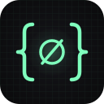

<p align="center">
  
</p>

<h1 align="center">agentjail</h1>

<p align="center">Minimal Linux sandboxes for running untrusted code.</p>

agentjail runs a command as a child process inside fresh Linux
namespaces, pivot-rooted into a minimal root filesystem, with a seccomp
filter, Landlock rules, cgroup v2 limits and an optional egress
allowlist. It is a Rust library: no VM, no daemon, no setuid helper.
The embedding process usually runs as root (cgroups, veth); the jailed
process never runs as host uid 0.

It is meant for code you don't trust to run as you: model-generated
code, `npm install` on an unfamiliar repository, a pull request's test
suite, a tool an agent picked.

> Beta. The core crate (`crates/agentjail`) is covered by CI as root on
> Ubuntu 24.04. The control plane, SDKs, web UI and gateway work, but
> their APIs may change before 1.0.

## Isolation

- **Namespaces** — user (default on), mount, network, IPC, PID. No UTS
  or cgroup namespace.
- **Never host root** — with a user namespace the jail's root maps to
  an unprivileged host id (`userns_id_base`, default 100000, when the
  embedder is root; the embedder's own uid otherwise). With
  `user_namespace: false` a root embedder drops the jail to `run_as`
  (default `nobody`, uid/gid 0 rejected). The trees the jail must write
  are re-owned to that id on each spawn.
- **Filesystem** — the root is a private read-only tmpfs at a
  128-bit-random path; `pivot_root` into it, old root
  `umount2(MNT_DETACH)`-ed. Bind `/bin /lib /usr` ro.
  tmpfs `/etc` with the bare minimum for dynamic linking + DNS.
  Fresh `/proc` for the PID namespace, masked like runc's default
  (`/proc/sys`, `/proc/sysrq-trigger` … read-only; `/proc/kcore`,
  `/proc/keys` … hidden). Landlock (default on, Linux ≥ 5.13) is applied
  after the pivot: read+exec on `/bin /lib /lib64 /usr /opt/flavors`,
  read on `/etc /proc`, device access on `/dev`, read/write on `/tmp`,
  read/write/exec on `/output`, read+exec on `/workspace` (read/write
  with `source_rw`), nothing else. `Jail::new` fails if `landlock: true`
  and the kernel lacks Landlock.
- **Network** — `None`, `Loopback`, or `Allowlist(domains)`. Allowlist
  routes through a per-jail HTTP CONNECT proxy: accepts only the jail's
  own address, `CONNECT`s only to allowlisted hosts on allowed ports
  (default `443`; `proxy_allowed_ports` or
  `AGENTJAIL_PROXY_ALLOWED_PORTS`), resolves once, rejects
  private/link-local/loopback/CGNAT/test-net, dials the IP not the
  hostname (closes DNS rebinding). Limits per jail: 64 concurrent
  connections, 10 s to send the request head (32 KiB max), 10 s
  upstream connect, 5 min idle. Veth via netlink, no `ip` binary.
- **Host firewall** — an nftables table (`inet agentjail`, installed
  by running `nft` and reinstalled if it disappears) lets a jail reach only its own proxy port on
  the host and drops everything else from or routed through `aj-h*`
  interfaces, so a jail can't reach host services or other jails.
  `firewall` / `AGENTJAIL_FIREWALL`: `auto` (default: install if `nft`
  exists, else warn and rely on the proxy's source check), `nft` (fail
  the spawn if it can't be installed), `off` (manage it yourself).
- **Syscalls** — seccomp-BPF blocklist (`Standard`/`Strict`).
  Kills foreign-architecture syscalls and, on x86_64, x32 ones. Blocks
  `unshare`, `setns`, mount, module, keyring, BPF, perf, io_uring,
  `chroot`, `name_to_handle_at`, `ptrace`, `personality`,
  `mount_setattr`, `memfd_create`, `fanotify_init`, `quotactl`,
  `syslog`, and `clone` with any `CLONE_NEW*` flag (plain
  fork/threads still work). `clone3` returns `ENOSYS` so libc falls
  back to the filtered `clone`. Arg-filters `ioctl(*, TIOCSTI, …)` and
  `socket(AF_NETLINK|AF_PACKET|AF_VSOCK, …)`.
- **Privileges** — `PR_SET_NO_NEW_PRIVS`, `close_range(3, ~0, CLOEXEC)`
  before exec, full bounding-set drop, `SECBIT_NOROOT_LOCKED |
  SECBIT_NO_SETUID_FIXUP_LOCKED`, `capset` zeroing every effective /
  permitted / inheritable cap in the grandchild after `/proc` is
  remounted in the new PID namespace.
- **Resources** — memory, CPU, PIDs, disk I/O via cgroup v2. Barrier
  pipe: child blocks until the parent has assigned the cgroup, so
  there's no unconstrained startup window.

## Requirements

- Linux ≥ 5.13 with Landlock enabled (or `landlock: false`), cgroup v2,
  user namespaces.
- Rust 1.88+ (edition 2024).
- `CAP_NET_ADMIN` — Allowlist mode only (veth + netlink); `nft`
  (nftables) on `PATH` for the host firewall.
- cgroup limits need agentjail alone in its cgroup (v2 leaf rule): it
  moves itself into `<cgroup>/agentjail-init` and delegates
  controllers. Tests use
  [`cgroup_leaf_runner.sh`](crates/agentjail/tests/support/cgroup_leaf_runner.sh).

## Use

```toml
[dependencies]
# Not on crates.io (the `agentjail` name there is an unrelated crate).
agentjail = { git = "https://github.com/joydle/agentjail" }
tokio = { version = "1", features = ["rt-multi-thread", "macros"] }
anyhow = "1"
```

```rust
use agentjail::{Jail, JailConfig, preset_build};

#[tokio::main]
async fn main() -> anyhow::Result<()> {
    // Defaults: user namespace + Landlock + Standard seccomp.
    let jail = Jail::new(preset_build("./src", "./out"))?;
    let out  = jail.run("npm", &["run", "build"]).await?;
    println!("exit={} oom={}", out.exit_code, out.oom_killed);
    Ok(())
}
```

### Presets

| Preset | Network | Memory | Timeout |
|---|---|---|---|
| `preset_build`   | None       | 512 MB | 600 s |
| `preset_install` | Allowlist  | 512 MB | 600 s |
| `preset_agent`   | None       | 256 MB | 300 s |
| `preset_gpu`     | None       | 8 GB   | 3600 s |
| `preset_dev`     | Loopback   | 1 GB   | 3600 s |

`preset_install` requires explicit domains:

```rust
preset_install("./src", "./out", vec![
    "registry.npmjs.org".into(),
    "registry.yarnpkg.com".into(),
])
```

### Config

```rust
use agentjail::{Jail, JailConfig, Network, SeccompLevel};

let jail = Jail::new(JailConfig {
    source:        "/code".into(),       // ro at /workspace
    output:        "/artifacts".into(),  // rw at /output
    network:       Network::None,
    seccomp:       SeccompLevel::Standard,
    memory_mb:     Some(512),            // None = no memory limit
    cpu_percent:   100,                  // 100 = 1 core
    max_pids:      64,
    io_read_mbps:  100,
    io_write_mbps: 50,
    timeout_secs:  300,
    ..Default::default()
})?;
```

Other knobs: `user_namespace` / `userns_id_base` / `userns_id_count`,
`run_as` (no user namespace, root embedder), `inherit_stdin` (default
`false`: stdin is `/dev/null`), `landlock`, `source_rw`,
`readonly_overlays`, `firewall`, `proxy_allowed_ports`. `Jail::new`
validates the config: `memory_mb: Some(0)`, overflowing limits,
`pid_namespace: false`, or an id that maps to host root are
`BadConfig` errors.

`spawn` can be called from any thread: every fork runs on one internal
process-lifetime thread, so a jail dies with the embedder process, not
with the calling thread.

### Network

```rust
Network::Allowlist(vec![
    "api.anthropic.com".into(),
    "registry.npmjs.org".into(),
    "*.mcp.example.com".into(),
])
```

Hostname checked against the allowlist, resolved, every
private/loopback/link-local/CGNAT/test-net IP filtered, connect to
what's left. TLS passes through (HTTPS, SSE, WebSocket).

### GPU

Trusted workloads only — exposes the NVIDIA kernel-driver attack
surface.

```rust
JailConfig { gpu: GpuConfig { enabled: true, devices: vec![0] },
             ..Default::default() }
```

### Monitoring

`JailHandle::stats()` reads live memory, CPU, PID and I/O counters from
the jail's cgroup; `Output` reports `oom_killed` and `timed_out`.
`Jail::spawn_with_events` streams stdout/stderr lines and completion as
`JailEvent`s. See the rustdoc (`cargo doc -p agentjail --open`).

### Snapshots and live forks

Save the output dir, restart from it later. Or branch a running jail:
it is frozen for the duration of the copy (sub-millisecond with
reflinks), which is useful for running N variants of an agent off one
warm state.

```rust
let snap = Snapshot::create(&output, &snapshot_dir)?;
snap.restore()?;

// FICLONE reflink where supported (btrfs, xfs, bcachefs); regular
// copy elsewhere. The source jail is frozen during the clone and the
// fork fails if it can't be (no cgroup, no freezer).
let handle = jail.spawn("python", &["train.py"])?;
let (forked, _info) = jail.live_fork(Some(&handle), "/tmp/fork-out")?;
```

Incremental snapshots (`Snapshot::create_incremental`) store files in a
BLAKE3 content-addressed pool; unchanged files (same size, ctime and
inode) reuse the prior blob. Snapshots walk the tree by directory fd and
never follow a symlink, so a running jail can't redirect them to host
files. Restore strips setuid/setgid bits and rejects manifest entries
with absolute or `..` paths.

## Threat model

What is in scope, and the regression test behind each protection, is in
[SECURITY.md](SECURITY.md).

## Limits

- Linux only. Not a VM — a kernel exploit escapes. For stronger
  isolation, pair with [gVisor](https://gvisor.dev) or run inside
  [Firecracker](https://firecracker-microvm.github.io).
- Beta. The seccomp filter is a blocklist, not an allowlist. Treat a
  jail as one layer of defence; for hostile workloads run the embedder
  in a VM or on a disposable host. See [SECURITY.md](SECURITY.md).
- The host firewall shells out to `nft`; there is no netlink nftables
  backend and no iptables backend. Without `nft` (`auto` mode) a jail
  can reach host services on its gateway address; set
  `AGENTJAIL_FIREWALL=nft` to make that a spawn error.
- By default every jail's root maps to the same host id (100000), so
  concurrent jails share a host uid; raise `userns_id_count` to give
  each spawn its own.
- The x32 kill rule is unit-tested on an emulated filter everywhere,
  but only executed for real on x86_64 hosts.
- GPU mode widens the attack surface to the NVIDIA driver.
- Allowlist mode costs one veth pair per concurrent jail. Stale
  interfaces are reaped at `agentjail-server` startup.

## Control plane

`agentjail-server` adds an HTTP control plane on top of the library:
per-tenant API keys, phantom credentials (sandboxes get `phm_<hex>`
tokens; a proxy swaps in the real upstream key), persistent workspaces,
snapshots, forks, runtime flavors, a hostname-routed gateway, a web UI,
and Node and Python SDKs. See [docs/control-plane.md](docs/control-plane.md).

```bash
make setup && set -a && source .env.local && set +a
docker compose -f docker-compose.platform.yml up --build
```

## Build and test

Internals and invariants for contributors: [`docs/architecture.md`](docs/architecture.md).

```bash
make test-rust                     # unprivileged unit tests (Docker)
make test-rust-privileged          # full security suite (--privileged)
make test-rust-privileged-clone    # end-to-end clone jail + workspace exec
( cd packages/sdk-node    && npm ci && npm test )
( cd packages/sdk-python  && uv sync --extra dev && uv run pytest )
( cd web && bun install && bun run build )
```

GPU tests need an NVIDIA GPU + the
[Container Toolkit](https://docs.nvidia.com/datacenter/cloud-native/container-toolkit/install-guide.html):

```bash
docker compose run --rm gpu cargo test --test gpu_test -- --nocapture
```

## License

MIT. See [LICENSE](LICENSE).
